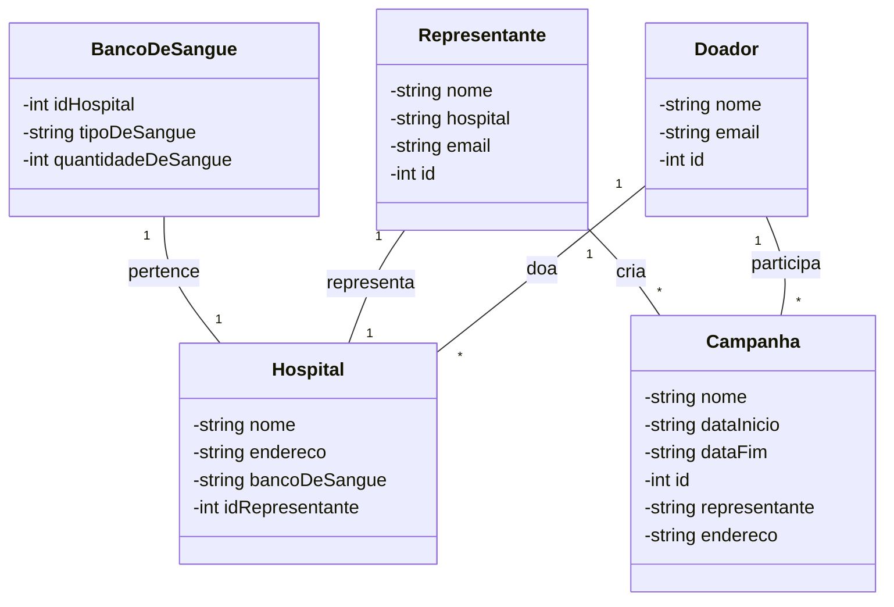
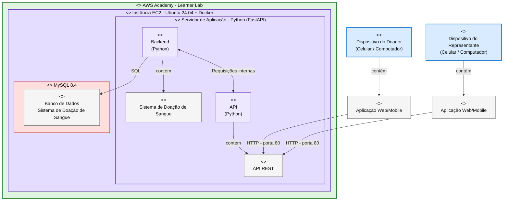
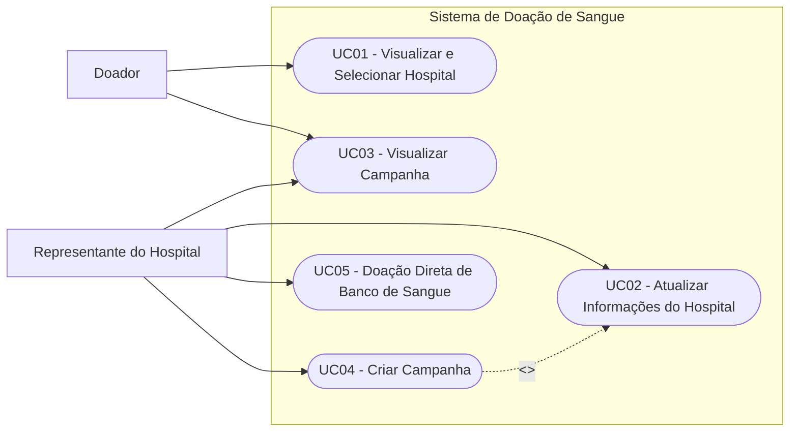

# Projeto-Doação-de-Sangue-

# links auxiliares

Link Google Docs: https://docs.google.com/document/d/1fZguRS95zDG2ZQ4rsJeOO61aht4fMMbfmpGLaomVKtQ/edit?usp=sharing

Link Google Sheets: https://docs.google.com/spreadsheets/d/1bja-UOTeAVHtsSLmCIZyrKeJUPVNS2Ls6BIC09AyRK8/edit?usp=sharing

Link Figma: https://www.figma.com/make/pD13GNYTOk4aVPxW0MsAe0/Doa%C3%A7%C3%A3o-de-Sangue-App?t=81aICpOhMsjMJMW5-20&fullscreen=1

## Implementação

- [`backend/`](backend/README.md) — API REST em Python (FastAPI) + MySQL, cobrindo os casos de uso UC02 (atualizar informações do hospital), UC03 (visualizar campanhas) e UC04 (criar campanha).
  - **No computador:** `cd backend && docker compose up -d --build` e abra http://localhost:8000/docs
    (ou rode com Python + SQLite, sem Docker — veja o [README do backend](backend/README.md#rodar-no-computador)).
  - **Na nuvem:** hospedado numa EC2 do AWS Academy (Learner Lab), instalada pelo script
    [`backend/deploy/aws/instalar.sh`](backend/deploy/aws/instalar.sh) — passo a passo em
    [Publicar no AWS Academy](backend/README.md#publicar-no-aws-academy-learner-lab).

## Diagrama de Classes

# Diagrama de implantação

# Diagrama de casos de Uso

