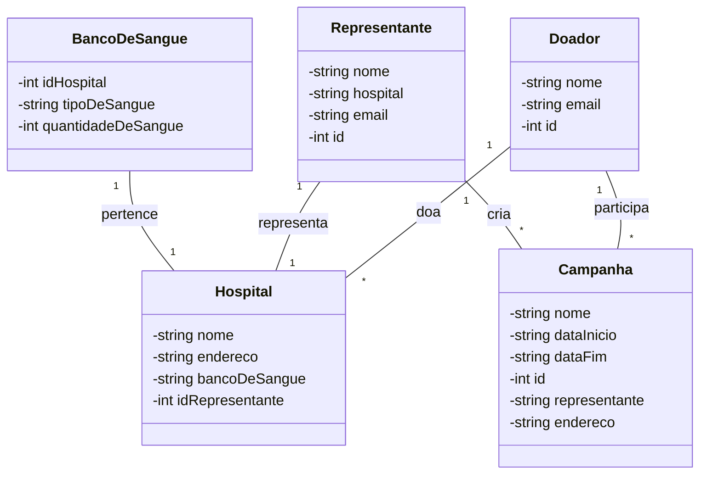
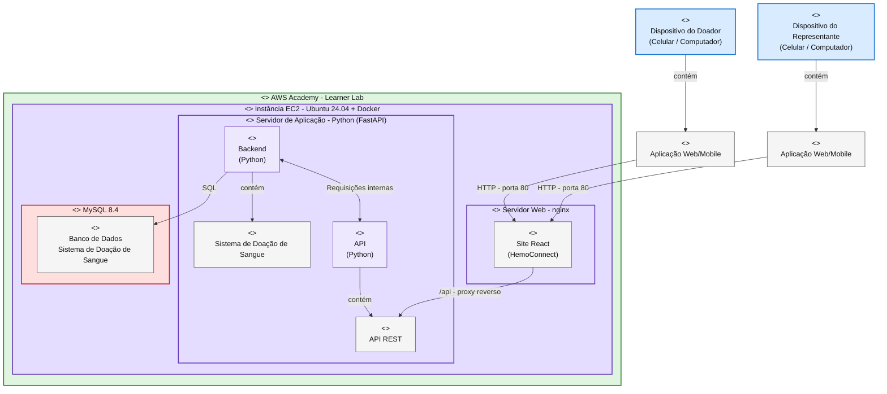

# Projeto-Doação-de-Sangue-

# links auxiliares

Link documentação: https://docs.google.com/document/d/1-0njLdNC9onfyT13B2m0jX5hVVVdCaU7zJiurWz5dfg/edit?usp=drivesdk

Link Google Docs: https://docs.google.com/document/d/1fZguRS95zDG2ZQ4rsJeOO61aht4fMMbfmpGLaomVKtQ/edit?usp=sharing

Link Google Sheets: https://docs.google.com/spreadsheets/d/1bja-UOTeAVHtsSLmCIZyrKeJUPVNS2Ls6BIC09AyRK8/edit?usp=sharing

Link Figma: https://www.figma.com/make/pD13GNYTOk4aVPxW0MsAe0/Doa%C3%A7%C3%A3o-de-Sangue-App?t=81aICpOhMsjMJMW5-20&fullscreen=1

## Implementação

- [`frontend/`](frontend/README.md) — site em React + Vite feito a partir do protótipo do Figma, ligado à API:
  campanhas para os doadores (UC03), login e painel do hospital (UC02) e criação de campanhas (UC04).
- [`backend/`](backend/README.md) — API REST em Python (FastAPI) + MySQL, cobrindo os casos de uso UC02 (atualizar informações do hospital), UC03 (visualizar campanhas) e UC04 (criar campanha).

**Como rodar**

- **Tudo com Docker:** `cd backend && docker compose up -d --build` → site em http://localhost:3000
  e API em http://localhost:8000/docs.
- **Sem Docker:** suba a API pelo [README do backend](backend/README.md#rodar-no-computador) e o site
  pelo [README do frontend](frontend/README.md#rodar-no-computador).
- **Na nuvem (AWS Academy):** o script [`backend/deploy/aws/instalar.sh`](backend/deploy/aws/instalar.sh)
  instala tudo numa EC2. O passo a passo está em [`backend/deploy/aws/README.md`](backend/deploy/aws/README.md).

 
# HemoConnect — Sistema de Doação de Sangue

## 1. Sobre o projeto

O HemoConnect é uma aplicação web desenvolvida para facilitar a divulgação de campanhas de doação de sangue e auxiliar hospitais no gerenciamento de suas informações e estoques sanguíneos.

A plataforma permite que representantes hospitalares atualizem informações institucionais, controlem os estoques de sangue e criem campanhas de doação. Os usuários podem consultar as campanhas disponíveis e visualizar os tipos sanguíneos necessários.

## 2. Funcionalidades

### Funcionalidades implementadas

- Cadastro de representantes hospitalares.
- Login e autenticação utilizando JWT.
- Atualização das informações dos hospitais.
- Gerenciamento do estoque sanguíneo.
- Identificação automática de tipos sanguíneos em falta.
- Consulta e listagem de campanhas.
- Visualização dos detalhes das campanhas.
- Criação de campanhas de doação.
- Validação das regras de negócio.

### Escopo

| Caso de uso | Descrição | Situação |
|---|---|---|
| UC01 | Visualizar e selecionar hospital | Fora do escopo |
| UC02 | Atualizar informações do hospital | Implementado |
| UC03 | Visualizar campanhas | Implementado |
| UC04 | Criar campanhas | Implementado |
| UC05 | Doação direta ao banco de sangue | Fora do escopo |

## 3. Tecnologias utilizadas

- React 19
- TypeScript
- Vite
- Python
- FastAPI
- SQLAlchemy
- MySQL 8.4
- SQLite
- Pytest
- Docker
- Nginx

## 4. Estrutura do projeto

```text
Projeto_doacao_de_sangue/
├── backend/
│   ├── app/
│   │   ├── routers/
│   │   ├── services/
│   │   ├── models.py
│   │   ├── schemas.py
│   │   ├── security.py
│   │   └── main.py
│   ├── tests/
│   ├── scripts/
│   ├── deploy/
│   ├── Dockerfile
│   ├── docker-compose.yml
│   └── README.md
├── frontend/
│   ├── src/
│   │   ├── components/
│   │   └── pages/
│   ├── Dockerfile
│   └── README.md
├── Diagrama_Sequencia.md
├── Diagrama_casos_de_uso.md
├── Diagrama_classe.md
├── Diagrama_implantacao.md
└── README.md
```

## 5. Como instalar e executar

### Requisitos

- Git
- Docker e Docker Compose (opcional)
- Python
- Node.js 22 ou 20.19+
- npm

### Clonar o repositório

```bash
git clone https://github.com/Derickin06/Projeto_doacao_de_sangue.git

cd Projeto_doacao_de_sangue
```

### Executar com Docker

```bash
cd backend

docker compose up -d --build
```

Para inserir dados de demonstração:

```bash
docker compose exec api python -m scripts.seed
```

Acessos:

- Sistema: http://localhost:3000
- API: http://localhost:8000/docs

### Executar manualmente

Backend:

```bash
cd backend

python -m venv .venv
```

Ative o ambiente virtual e instale as dependências:

```bash
pip install -r requirements.txt
```

Execute os testes:

```bash
pytest
```

Carregue os dados de demonstração:

```bash
python -m scripts.seed
```

Inicie a API:

```bash
uvicorn app.main:app --reload
```

Frontend, em outro terminal:

```bash
cd frontend

npm install

npm run dev
```

A aplicação ficará disponível em:

http://localhost:5173

## 6. Testes automatizados

O backend possui testes automatizados utilizando Pytest.

Os arquivos estão localizados em:

```text
backend/tests/
├── test_auth.py
├── test_campanhas.py
├── test_compatibilidade.py
└── test_hospitais.py
```

Para executar:

```bash
cd backend

pytest
```

Na execução de validação realizada durante a preparação desta documentação, foram obtidos:

- 22 testes aprovados.
- 70 subtestes aprovados.
- Nenhuma falha.

## 7. Documentação

A documentação complementar contempla:

- Descrição do projeto.
- Arquitetura do sistema.
- Funcionalidades implementadas.
- Regras de negócio.
- Casos de uso.
- Estrutura do banco de dados.
- Casos de teste.
- Manual de instalação.
- Manual de utilização.
- Implantação em nuvem.

Os diagramas estão disponíveis nos arquivos Markdown da raiz do repositório.

## 8. Materiais auxiliares

- [Protótipo Figma](https://www.figma.com/make/pD13GNYTOk4aVPxW0MsAe0/Doa%C3%A7%C3%A3o-de-Sangue-App)
- [Documentação Google Docs](https://docs.google.com/document/d/1fZguRS95zDG2ZQ4rsJeOO61aht4fMMbfmpGLaomVKtQ/edit)
- [Planilha Google Sheets](https://docs.google.com/spreadsheets/d/1bja-UOTeAVHtsSLmCIZyrKeJUPVNS2Ls6BIC09AyRK8/edit)

## 9. Implantação

O projeto possui scripts de implantação para AWS Academy utilizando uma instância EC2 com Docker.

Consulte:

`backend/deploy/aws/README.md`

## 10. Considerações finais

O HemoConnect busca utilizar a tecnologia para facilitar a divulgação de campanhas de doação de sangue e auxiliar os hospitais na organização das informações relacionadas aos seus estoques.

O projeto possui uma estrutura que permite futuras melhorias e a implementação de novas funcionalidades.

## 11. Repositório

https://github.com/Derickin06/Projeto_doacao_de_sangue


## Diagrama de Classes



# Diagrama de implantação



# Diagrama de casos de Uso


