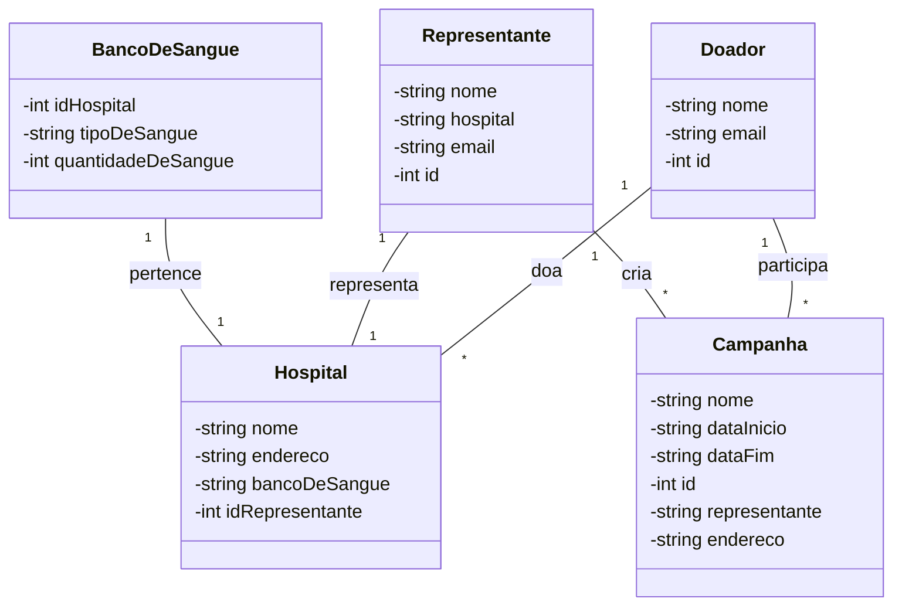
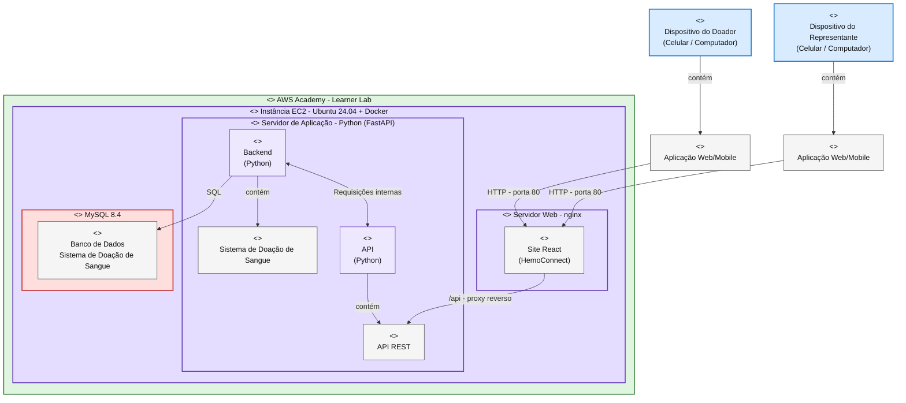
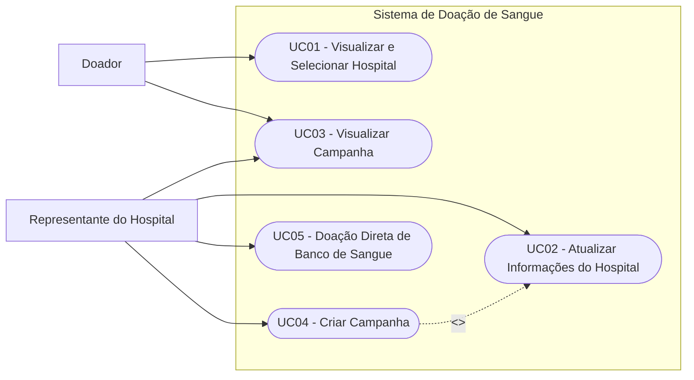

# Projeto-Doação-de-Sangue-

# links auxiliares

Link Google Docs: https://docs.google.com/document/d/1fZguRS95zDG2ZQ4rsJeOO61aht4fMMbfmpGLaomVKtQ/edit?usp=sharing

Link Google Sheets: https://docs.google.com/spreadsheets/d/1bja-UOTeAVHtsSLmCIZyrKeJUPVNS2Ls6BIC09AyRK8/edit?usp=sharing

Link Figma: https://www.figma.com/make/pD13GNYTOk4aVPxW0MsAe0/Doa%C3%A7%C3%A3o-de-Sangue-App?t=81aICpOhMsjMJMW5-20&fullscreen=1

## Implementação

- [`frontend/`](frontend/README.md) — site em React + Vite feito a partir do protótipo do Figma, ligado à API:
  campanhas para os doadores (UC03), login e painel do hospital (UC02) e criação de campanhas (UC04).
- [`backend/`](backend/README.md) — API REST em Python (FastAPI) + MySQL, cobrindo os casos de uso UC02 (atualizar informações do hospital), UC03 (visualizar campanhas) e UC04 (criar campanha).

**Como rodar**

- **Tudo com Docker:** `cd backend && docker compose up -d --build` → site em http://localhost:3000
  e API em http://localhost:8000/docs.
- **Sem Docker:** suba a API pelo [README do backend](backend/README.md#rodar-no-computador) e o site
  pelo [README do frontend](frontend/README.md#rodar-no-computador).
- **Na nuvem (AWS Academy):** o script [`backend/deploy/aws/instalar.sh`](backend/deploy/aws/instalar.sh)
  instala tudo numa EC2. O passo a passo está em [`backend/deploy/aws/README.md`](backend/deploy/aws/README.md).

## Diagrama de Classes

# Diagrama de implantação

# Diagrama de casos de Uso

